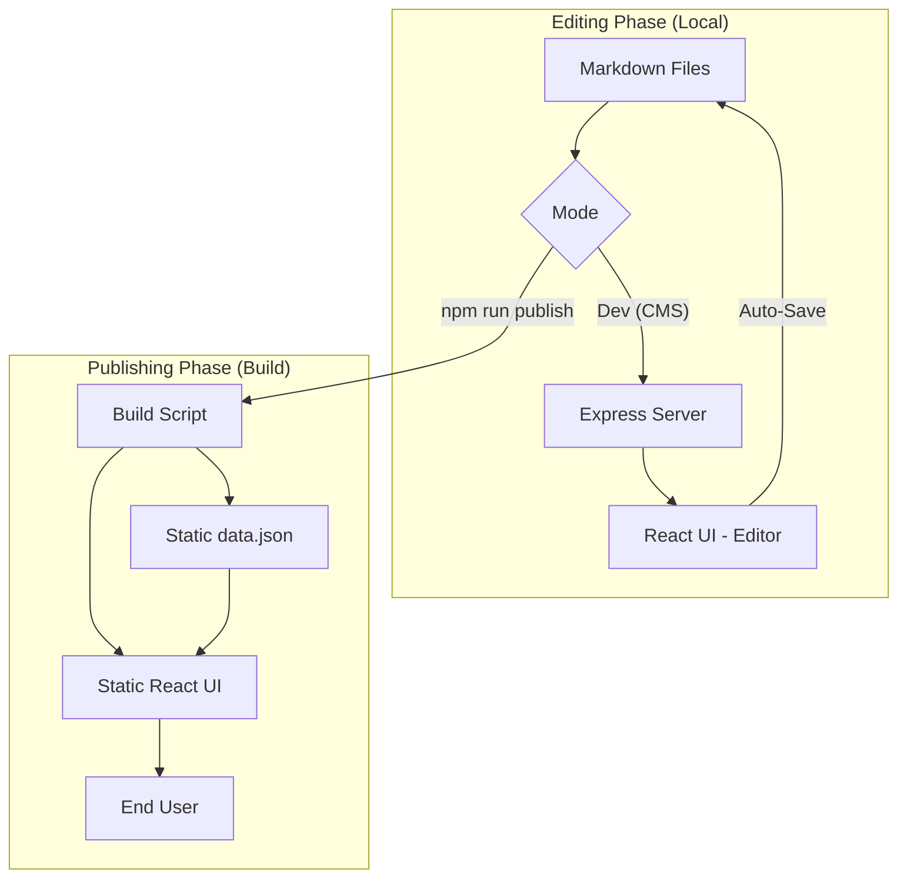
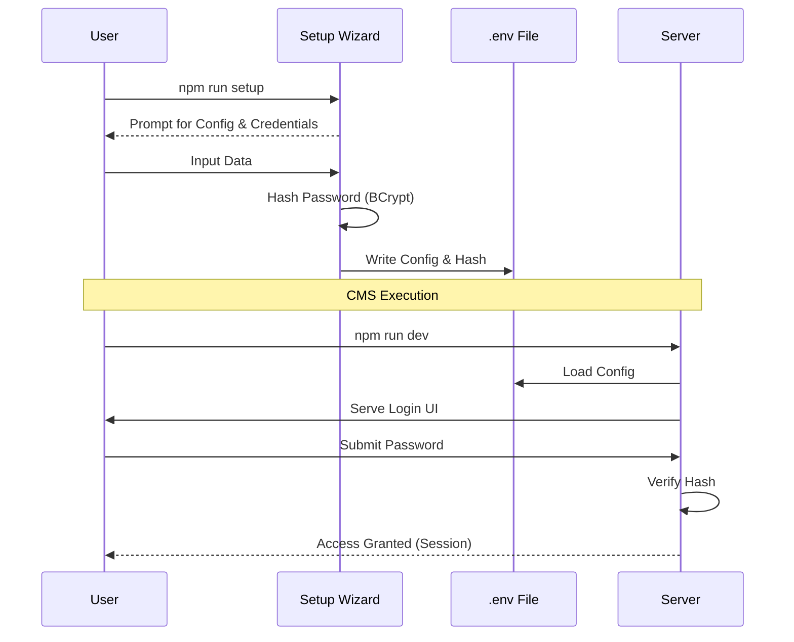
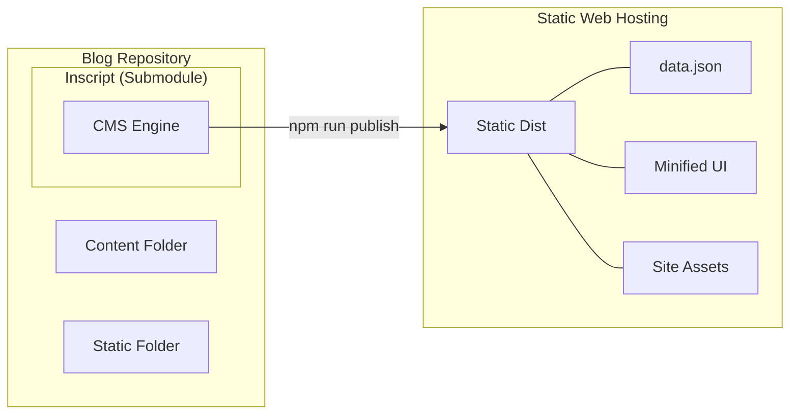

# Inscript

A unified system that helps you write and publish your markdown-based blog. A modern, "plug and play" CMS built with React, Vite, Express, and Tailwind CSS.
Designed to be a seamless submodule for any static site generator (Hugo, Astro, Next.js, etc.).

## 🎮 Live Demo
Try the editor in your browser without installing anything!
[**Launch Live Demo**](https://inscript.harshankur.com/inscript_demo.html)

**Demo Credentials**: `demo` / `demo`

> **Note**: The demo runs entirely in your browser using `localStorage`. No data is sent to a server.


## Features

### 🛡️ Production-Grade Security
-   **Local Auth**: Secure your CMS with a local username and password.
-   **BCrypt Hashing**: Passwords are securely hashed using industry-standard BCrypt.
-   **Session Management**: Secure, HTTP-only session cookies with 24-hour persistence.
-   **Interactive Logout**: Robust logout flow with a confirmation modal to prevents accidental sign-outs.

### 📝 Rich Text Editor
-   **Tiptap Power**: A Notion-style editor ([inscript-editor](https://www.npmjs.com/package/inscript-editor)) with slash commands (`/`) for quick formatting and inserting images, videos, tables, diagrams and more.
-   **Formatting**: Bold, Italic, Underline, Strike, Sub/Superscript, Alignment, and Code Blocks.
-   **Visuals**:
    -   **Images**: Drag & drop upload, resize, and extensive media library integration.
    -   **YouTube**: Embed videos directly via URL or search, with an optional caption.
    -   **Embeds**: Other embedded content (maps, players) shows a click-to-load placeholder, so nothing third-party loads until you ask.
    -   **Highlights**: Vibrant multi-color highlighting text and theme-harmonized Editor/History active tab highlights.
    -   **Floating Selection Bubble Menu**: A context-aware popover menu on text selection equipped with standard formatters and a dedicated **Link Selector Tool** to instantly manage links.
-   **Writing Tools**: Checklists, tables, citations, footnotes, math, Mermaid diagrams, and wikilinks that link one post to another by its title.
-   **Hidden Comments**: `<!-- notes -->` in a post show as a chip while you edit and never appear to readers.
-   **Outline & Minimap**: A side rail with a clickable outline of the post's headings, or a minimap of the whole post.
-   **Focus Mode**: Hides everything but the text you're writing. The column keeps the width it had, so the text does not wrap anywhere else.
-   **Editor Settings**: The sliders button beside Focus Mode sets the line width, the text size, and whether focus mode keeps the editor's width or has a column of its own. They are a view preference, kept in your browser and never part of a post.
-   **Customizable Toolbar**: Choose which tools appear in the toolbar and the selection menu.
-   **Theme-Aware**: Content automatically adjusts for dark mode, ensuring perfect readability.
-   **WYSIWYG**: The look and feel of the CMS is exactly the same as the published blog. It is essentially the same application, ensuring there are no surprises in the final UI.

### 🗂️ Organization & Metadata
-   **Taxonomy**: Manage Tags and Categories with an intuitive UI.
-   **Dynamic Sidebar Tags**: Responsive tag display that automatically adjusts to sidebar width using a greedy heuristic, with snappy `+N` overflow tooltips.
-   **Resizable Category Sidebar**: Interactive drag-to-resize category folder pane to customize your sidebar layout.
-   **Consolidated Categories**: Streamlined taxonomy into four core buckets: **Development**, **Technology**, **Life**, and **Philosophy**.
-   **Global Internationalization (i18n)**: Native localization in 19 languages, editor included, with an elegant custom dropdown language selector integrated directly into the workspace.
-   **Frontmatter**: Automatically syncs YAML frontmatter (title, date, tags, etc.).
-   **Advanced Filtering**: Filter posts by tags, categories, draft status, and date ranges.

### ✨ Visual Polish & Symmetry
-   **Layout Symmetry**: Standardized critical UI dimensions (like the 74px height of the Introduction section and editor footer) for a professional, balanced aesthetic.
-   **Contrast Optimization**: Enhanced legibility for secondary UI elements including Dashboard tips, History View diffs, and Readonly mode toggles.
-   **Modern Chips**: Zinc-styled tags and chips that follow a cohesive design system.

### 💾 Robust Workflow
-   **Draft System**:
    -   **Auto-Save**: Unsaved work is kept as a draft on the server, saved as you type and again the moment you switch posts or leave the tab.
    -   **Version History**: Every change is a version you can undo, redo, compare and restore, and versions persist across sessions. Restoring an old version adds it as a new one, so nothing is ever lost.
    -   **Conflict Resolution**: If a post's file changes outside Inscript (a `git pull`, another editor) while it has a draft, the file's new content opens as a "Changed outside the app" version, with your draft's versions still there to restore.
-   **Faithful Markdown**: Posts are saved as clean Markdown: checklists as `- [x]` task items, tables as GFM tables, and anything Markdown can't express (embeds, citations, resized images) as HTML, so a post reads back exactly as you left it.
-   **Publishing Flow**: Four steps, each of which can be done on its own from the button in the editor header:
    -   **Save**: Updates the markdown file locally.
    -   **Publish**: Generates a static API (`data.json`) for your frontend.
    -   **Commit**: Commits the changes to Git.
    -   **Push**: (Optional) Pushes the commits to your remote repo directly from the UI.

### 🛠️ Architecture
-   **FileSystem Based**: 100% flat-file based. No database required.
-   **Headless**: Generates a framework-agnostic `data.json` that any frontend can consume.
-   **Hybrid Mode**:
    -   **Dev**: Runs an Express server for file I/O.
    -   **Prod**: Builds to a static React app for readonly viewing.

## Installation

This tool is best installed as a **Git Submodule** within your blog's repository.

### 1. Add Submodule
Run this from your project root:

```bash
git submodule add <repository-url> inscript
```

### 2. Install & Setup
Navigate to the Inscript folder and run the interactive setup wizard:

```bash
cd inscript
npm install
npm run setup
```

The wizard will guide you through:
-   Configuring your blog identity.
-   Setting up your content and static directories.
-   Enabling authentication and setting your secure credentials.

> [!TIP]
> **Forgot your credentials?**
> If you lose access, simply open your `.env` file and delete the `AUTH_USERNAME` and `AUTH_PASSWORD_HASH` lines. The next time you run `npm run dev` or `npm run setup`, you will be prompted to create new credentials.

## 🐳 Docker Support

You can run Inscript entirely through Docker for a consistent and isolated environment.

### 1. Simple Start
If you just want to see it running, simply run:
```bash
docker-compose up -d
```

### 🔐 Git Support (Submodule Flow)
When using Inscript as a submodule, you want Git commands (Commit/Push) to target your **Parent Blog Repository**, not just the engine.

1. **Enable Credentials**: Edit `docker-compose.yml` and uncomment the volumes for `.gitconfig` and `.ssh`.
2. **Mount Root**: Ensure the `- ../:/app/` volume is active (it is by default). This mounts your entire blog repo into the container.
3. **Identity**: The container will automatically use your host's Git identity and SSH keys.

#### 📁 Directory Structure inside Container
- **`/app`**: Your Parent Blog Repository (contains `.git`). Git commands run here.
- **`/app/inscript`**: The Inscript CMS engine. `npm run dev` runs here.
- **`/app/content`**, **`/app/static`**: Your blog data folders.

> [!IMPORTANT]
> The Docker image is pre-configured to trust the `/app` directory (`git config safe.directory`), allowing seamless operations on the mounted blog repo even if file ownership differs between Host and Container.
Inscript will detect it is running in Docker and **automatically generate** a `.env` file with safe defaults (`admin`/`admin` credentials) if one is missing.

### 2. Manual Configuration
For full control, copy the example template first:
```bash
cp .env.example .env
```
Then edit `.env` and run `docker-compose up`.

> [!IMPORTANT]
> **Docker Bind Mounts**: If you run `docker-compose up` without a `.env` file existing on your host machine, Docker may create a *directory* named `.env` instead of a file. If this happens, delete the directory and create an empty `.env` file before restarting.

## Usage

### Development (Writing Content)
Run Inscript locally alongside your blog generator:

```bash
npm run dev
```
-   **Inscript Interface**: `http://localhost:5173`
-   **API Server**: `http://localhost:2221` (default)

### Publishing (Building for Production)
When you deploy your site, you need to build the Inscript assets and generate the content API.

```bash
npm run publish
```

#### What `npm run publish` does:
1.  **Setup**: Generates `public/robots.txt` and `public/manifest.json` based on your configuration.
2.  **Build UI**: Builds the React app in `readonly` mode (no editing features).
3.  **Generate Data**: Parses all markdown files and creates a `dist/data.json` for your frontend. A post whose frontmatter has `draft: true` is left out, here and in the sitemap.
4.  **Sitemap**: Generates a SEO-ready `sitemap.xml` from `SITE_URL`, dating each post by its `modified` (else `created`) frontmatter, and adds a `Sitemap:` line pointing at it to `robots.txt` when that names none yet.
5.  **Assets**: Copies all images from `STATIC_DIR` to `DIST_DIR`.

## Deployment

### Netlify
To deploy this alongside your site on Netlify, add this to your **root** `netlify.toml`:

```toml
[build]
  # Adjust 'base' if your structure is different
  # This command builds the Inscript and outputs it to 'dist'
  command = "cd inscript && npm install && npm run publish"
  publish = "dist"
```

## 🏗️ System Architecture

### Content Lifecycle & Modes
Inscript operates in two distinct modes depending on your workflow stage.



### Security & Setup Flow
Behind the scenes, the setup wizard secures your environment before the CMS even starts.



### Deployment Strategy
Inscript is designed to follow a "Submodule-first" architecture, generating a headless API for your frontend.



### Deployment Environment Variables
When deploying to a provider like Netlify or Vercel, you must configure the following Environment Variables in their dashboard.

The build script `npm run setup` validates these before building.

| Variable | Required | Description | Example Value |
| :--- | :--- | :--- | :--- |
| `TITLE` | **Yes** | The blog title: the page's `<title>`, the sidebar and the manifest. Unset, they read `Inscript`. | `My Tech Blog` |
| `SITE_URL` | **Yes** | Public URL (used in Sitemap/Robots). | `https://example.com` |
| `CONTENT_DIR` | **Yes** | Relative path to markdown content. | `../content` |
| `STATIC_DIR` | **Yes** | Relative path to source images/assets. | `../static` |
| `DRAFTS_DIR` | **Yes** | Path for drafts and version history. | `../drafts` |
| `DIST_DIR` | No | Override build output location. | `../dist` |
| `FAVICON` | No | Path to custom favicon in Static Dir. | `favicon-32x32.png` |
| `SERVER_PORT` | No | Port for the backend API server. | `2221` |
| `CLIENT_PORT` | No | Port for the frontend React app (Dev). | `2222` |
| `ALLOWED_HOSTS` | No | Comma-separated allowed hosts for backend. | `blog.me.com` |
| `AUTH_ENABLED` | No | Enable local password authentication. | `true` |
| `AUTH_USERNAME` | No | Admin username for login. | `admin` |
| `AUTH_PASSWORD_HASH` | No | BCrypt hash of your password. | `$2b$10$...` |
| `SESSION_SECRET` | With auth | Secret for signing session cookies. Setup generates it; the server will not start with authentication on and no secret. | `(any random string)` |
| `CORS_ORIGINS` | No | Other sites allowed to call the API, as comma-separated origins. None by default; the editor itself needs none. | `https://cms.me.com` |
| `ALLOW_PUSH` | No | Enable Git Push from the UI. The server refuses a push unless this is exactly `true`. | `false` |
| `FOOTER_COPYRIGHT_HOLDER` | No | Name in the footer's copyright line `<TITLE> © <year> <holder>`. | `Jane Doe` |
| `FOOTER_COPYRIGHT_URL` | No | Link for that name. | `https://janedoe.com` |
| `FOOTER_COPYRIGHT_YEAR` | No | Year in the copyright line (the year the site was first published). | `2026` |
| `FOOTER_LEGAL_NOTICE_URL` | No | Legal notice (Impressum) link, shown above the copyright line. | `https://janedoe.com/impressum` |
| `FOOTER_LEGAL_NOTICE_LABEL` | No | Fixed text of that link, in every language. Unset, it reads in the visitor's language (`Legal notice` in English, `Impressum` in German). | `Imprint` |
| `FOOTER_PRIVACY_URL` | No | Privacy notice link, next to the legal notice link. | `https://janedoe.com/privacy` |
| `FOOTER_PRIVACY_LABEL` | No | Fixed text of that link, in every language. Unset, it reads in the visitor's language (`Privacy` in English, `Datenschutz` in German). | `Privacy policy` |
| `FOOTER_PRIVACY_URLS` | No | The privacy notice for visitors of other languages, as comma-separated `<language>=<URL>` pairs. A listed language gets its address (in the footer, the YouTube placeholder and the counting question), every other one `FOOTER_PRIVACY_URL`. | `de=https://janedoe.com/datenschutz` |
| `VIEWCOUNTER_URL` | No | Your [viewcounter](https://viewcounter.harshankur.com) instance, to count page views on the published site (see below). | `https://views.janedoe.com` |
| `VIEWCOUNTER_APP_ID` | No | The app ID the blog's views are stored under in that instance. Set with `VIEWCOUNTER_URL`. | `blog` |
| `VIEWCOUNTER_EDGE` | No | `true` when viewcounter's edge Worker counts the site's pages without consent, so the consent question says so. Default `false`. | `true` |
| `VIEWCOUNTER_OPERATOR` | No | Who runs the site, named by the consent question ("This site is run by Jane Doe."). Unset, it names no one; it is not taken from `FOOTER_COPYRIGHT_HOLDER`. One line, up to 100 characters. | `Jane Doe` |

The footer appears under an open post, on the home screen and on the login screen. With no
`FOOTER_*` set it shows only "Powered by Inscript"; each part appears once it is set. URLs must
be absolute `http(s)` URLs, which `npm run setup` checks. The demo build takes its values from
the committed `.env.demo`.

### Counting page views

Inscript can count the published site's page views with
[viewcounter](https://viewcounter.harshankur.com), a privacy-first view counter you run
yourself. Set `VIEWCOUNTER_URL` and `VIEWCOUNTER_APP_ID`, and add the app to the instance's
`allowed.json` with your `SITE_URL` among its origins. The published site then loads the
instance's `consent.js`, which asks each visitor whether their visits may be counted and only
with their yes loads viewcounter's tracker; the footer gets a **Privacy settings** button that asks
again, and the question links to your privacy notice (`FOOTER_PRIVACY_URL`, or the visitor's language's in
`FOOTER_PRIVACY_URLS`, which needs viewcounter 3.7.1 to follow a change of language in place). Each post counts as its own page
(`/?post=<name>`), and nothing else of an address is sent. Only on `SITE_URL`'s hostname is
anything loaded or the button shown, never on a preview or a local build, and the editor never counts anything.
If viewcounter's edge Worker stands in front of the site, set `VIEWCOUNTER_EDGE=true` and give the
site's entry in the Worker's `SITES` `"query": ["post"]`, so both count a post alike. Describe the
counting in your privacy notice.

### Advanced Build Configuration
If you need to change **where** the site is built (e.g. if your hosting provider expects a specific folder name like `public` or `build`), you can override the output directory using `DIST_DIR`.

1.  **Set the Variable**: In your hosting dashboard (Netlify/Vercel settings), add:
    ```env
    DIST_DIR=./build_output
    ```
    *(Note: This path is relative to the `inscript` folder)*

2.  **Update Publish Settings**: Ensure your hosting provider is configured to publish that same directory.
    *   **Netlify**: Update `publish = "inscript/build_output"` in `netlify.toml` or UI.
    *   **Vercel**: Update "Output Directory" in settings.

**Critical**: The `DIST_DIR` variable tells the build script where to put files. The Hosting Provider's "Publish Directory" setting tells the server which folder to serve. **These must match.**

### Self-Hosted
Serve the contents of the `DIST_DIR` (default `../dist` relative to Inscript) using Nginx, Apache, or any static file server.

## 🔐 Enabling Git Commit & Push

Inscript can handle your entire version control workflow. By default, **Push** is disabled for safety.

### 1. Enable Push Feature
Open your `.env` file and set the experimental flag:
```env
ALLOW_PUSH=true
```

### 2. Configure Git Identity
Ensure your host machine has Git configured:
```bash
git config --global user.name "Your Name"
git config --global user.email "you@example.com"
```

### 3. Docker Configuration
If running via Docker, you must share your host credentials by editing `docker-compose.yml`:

```yaml
volumes:
  # Share your Git global config
  - ${HOME:-~}/.gitconfig:/root/.gitconfig:ro
  # Share your SSH keys for pushing to GitHub/GitLab
  - ${HOME:-~}/.ssh:/root/.ssh:ro
```

### 4. Save, Publish, Commit and Push
The button in the editor header does the next step that has work left: **Save**, then **Publish**, **Commit**, **Push**. Its menu lists all four with what each has left, runs any one of them on its own, or finishes everything left. A step is never taken away because another is done: a saved post can still be published, and you can commit without publishing.

What each step has left is read from your files and Git, so it stays right after a reload, a pull, or work done outside the editor:
-   **Save** has work when the open post has unsaved changes.
-   **Publish** has work when a post or a file in `STATIC_DIR` is newer than `data.json` in `DIST_DIR`, or the site was never built.
-   **Commit** has work when Git sees changes (a submodule whose own files changed but whose commit did not is not one).
-   **Push** has work when the branch is ahead of its upstream. It is offered only when `ALLOW_PUSH=true`.

> [!TIP]
> **Submodule Awareness**: When Inscript is a submodule, it automatically detects the parent repository. Your commits and pushes will apply to the **Parent Blog Repository**, keeping your content and engine perfectly synced.

## Troubleshooting

-   **"Missing setup script"**: Ensure you run `npm run setup` if you accidentally deleted generated files.
-   **"Network Error"**: Make sure the backend server (port 3001) is running if you are in Dev mode.
-   **"Git Push Failed"**: 
    1. Verify `ALLOW_PUSH=true` is set in `.env`.
    2. If using Docker, ensure `.ssh` and `.gitconfig` volumes are correctly mounted and not commented out.
    3. Ensure your SSH keys are added to your SSH agent on the host.
-   **"git: not found"**: If running in Docker, you may need to rebuild your image to install Git: `docker-compose up -d --build`.

## License

MIT
